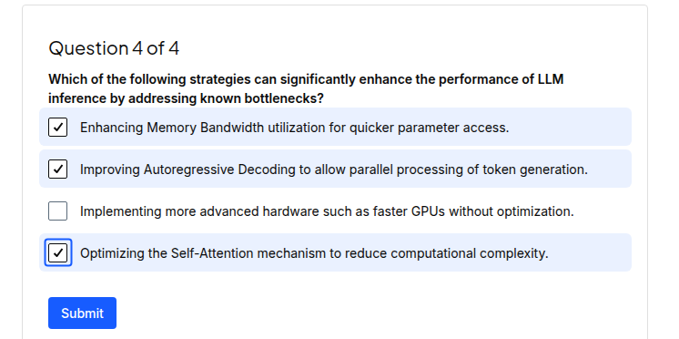
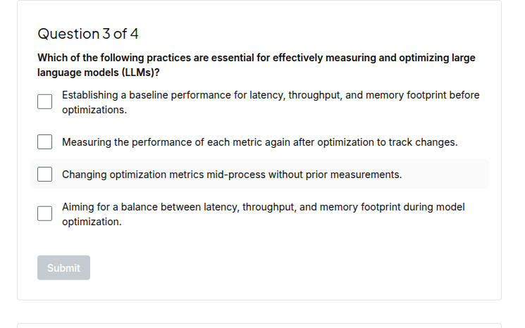
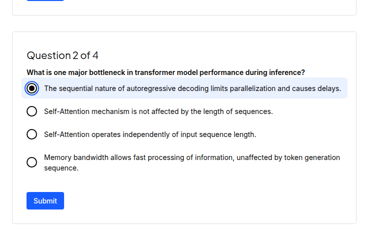
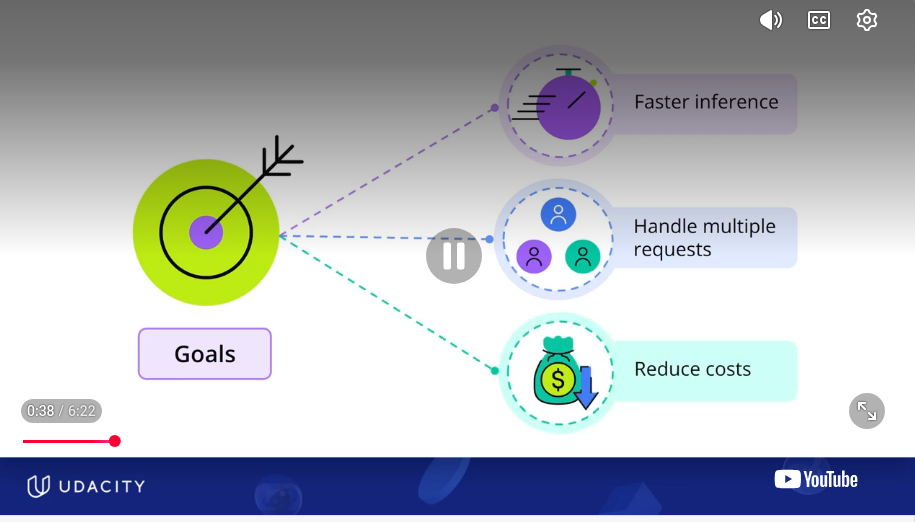
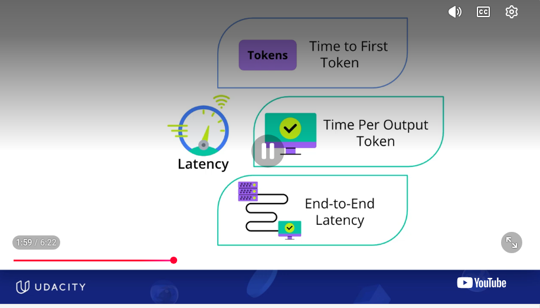
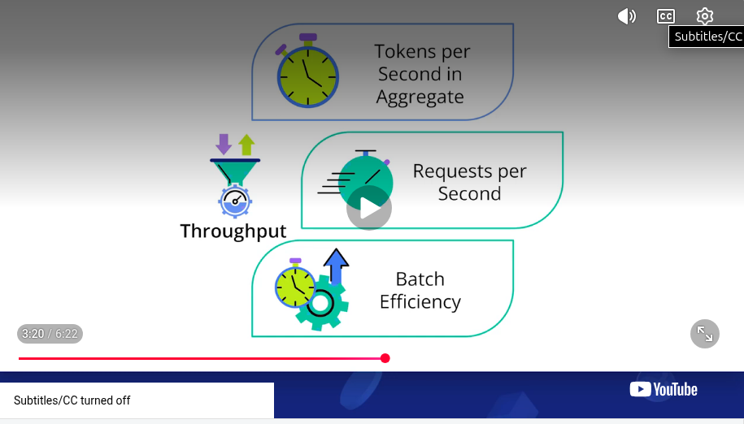
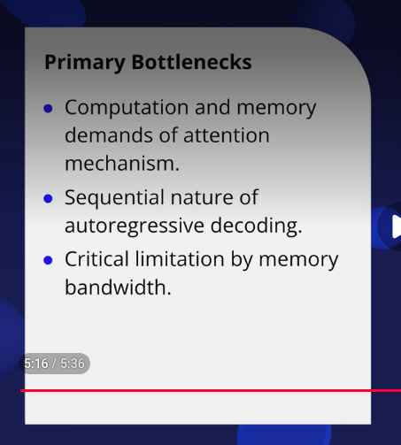
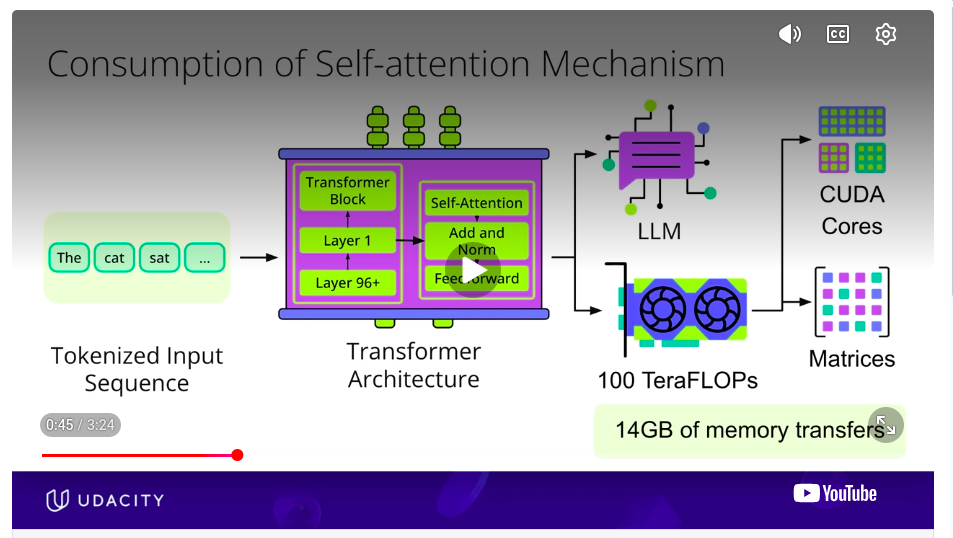
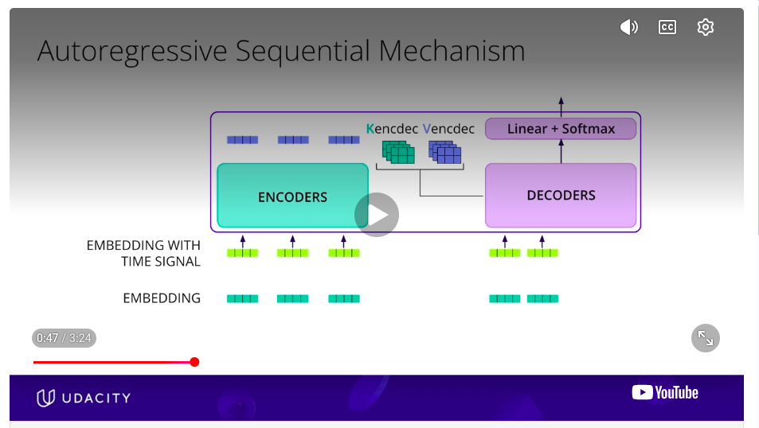
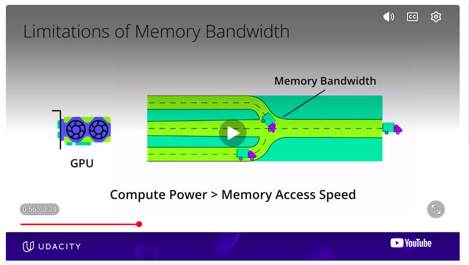

# 🎯 Transformer Inference Optimization
- Bottlenecks
- Goals
- Metrics
- Tools
- Solutions

## 🎯 1) Check Your Intuition
 
 
 

## 🎯 2) Goals : Metrics for Transformer Inference Optimization
Metrics
- Latency
- Throughput
- Memory/ Cost (not shown in pic)
- Perpelxity( this is not a metric for inference optimization apparently ???)
 
 

## 🎯 3) Bottle Necks
- attention mechanism : scales quadratically with sequence length
- auto regressive token generation : auto regressive decoding to generate tokens is sequential
- memory bandwidth limitations
 

### 🎯 3.1) Attention Mechanism & Sequence Length
Attention Mechanism scales quadratically with sequence Length i.e O(N*N)
KSW TODO: paste the picture of handwritten notes
 

### 🎯 3.2) Autoregresive Token Generation
Autoregressive decoding generates one token at a time. This makes the process inherently sequential
 

### 🎯 3.3) Memory Bandwidth Limitations
Limits how quickly you can deliver data to the compute units

## 🎯 4) Solutions
- **Transformer Architecture Transformations:** change things about the architecture 
see [text](../../lesson2_transformer_architecture_optimize/docs/README_inference_optimizations.md)
    - **KV Caching:** reduces the vast amount of redundant computations that happen due to step by step text generation
    - **GQA grouped query attention:** reduces the memory burden due to KV Caching
    - **Flash Attention:** Algorithm to speed up calculation by relying less on memory access. Speeds up core attention calculation
 
 

 ## 🎯 4.2) Shared KV / Grouped Query Attention- GQA
 - Attention is softmax(Q*Kt) i.e. Q and K are multiplied first, this doesnt mean KV cannot be shared
 See below for explanation. 
 - Note in the below screen shots I have mixed up Shared KV and KV Caching. (I have erroneusely called it Shared KV Caching.). **SHARED KV != KV Caching.** They are 2 different things. Althought Shared KV could also use KV Caching
- **Shared KV (GQA/MQA):** Multiple Query heads share the same Key and Value heads. This reduces the number of K/V heads needed. 
- In GQA: grouped query attentions with shared KV # attention_heads = # query_heads. Each decoder layer will have attention_heads. Many decoder layers connected serially make the decoder output
- **KV Caching:** Stores previously computed K and V vectors so they don't need to be recomputed for subsequent tokens.
  
  
 
 
 ## 🎯 4.2.1) Shared KV : 2 queries share 1 KV 
 
  
  
 
 ## 🎯 4.2.2) Shared KV : 4 queries share 1 KV 
 
  
  