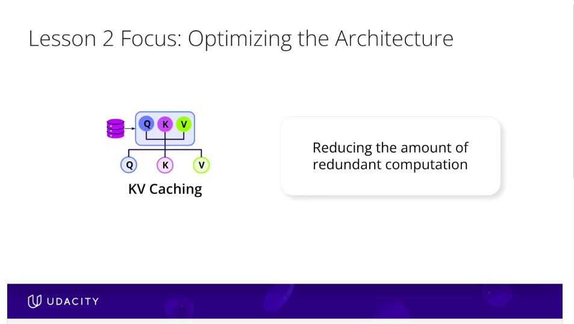
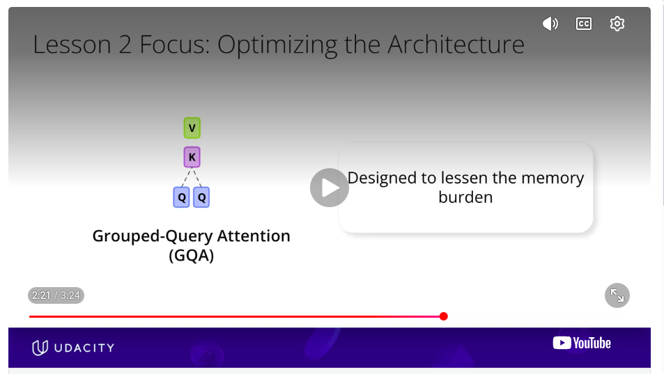
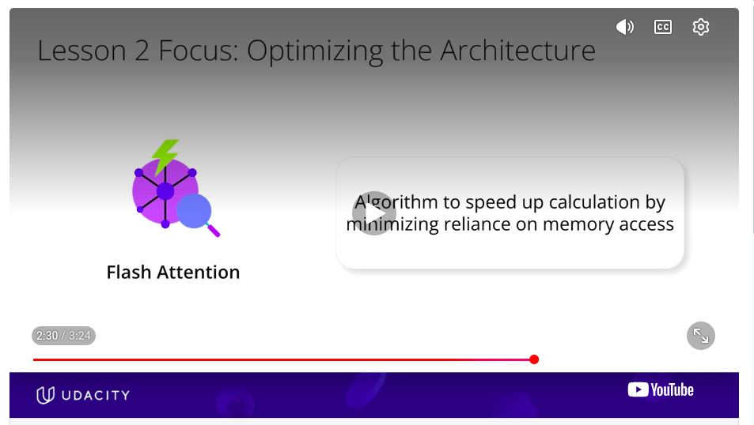

# Transformer Architecture Transformations
change things about the architecture 
- **KV Caching:** reduces the vast amount of redundant computations that happen due to step by step text generation
- **GQA grouped query attention:** reduces the memory burden due to KV Caching
- **Flash Attention:** Algorithm to speed up calculation by relying less on memory access. Speeds up core attention calculation
 
 

