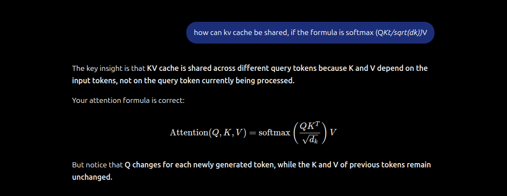
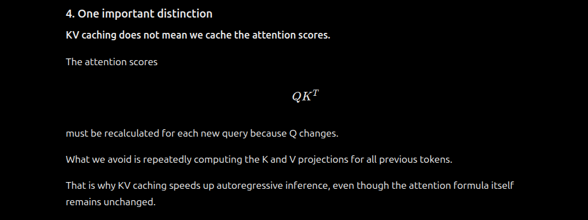
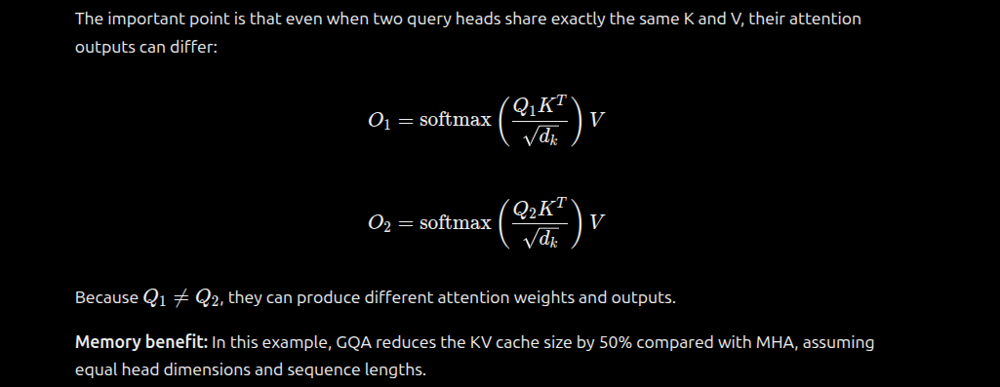
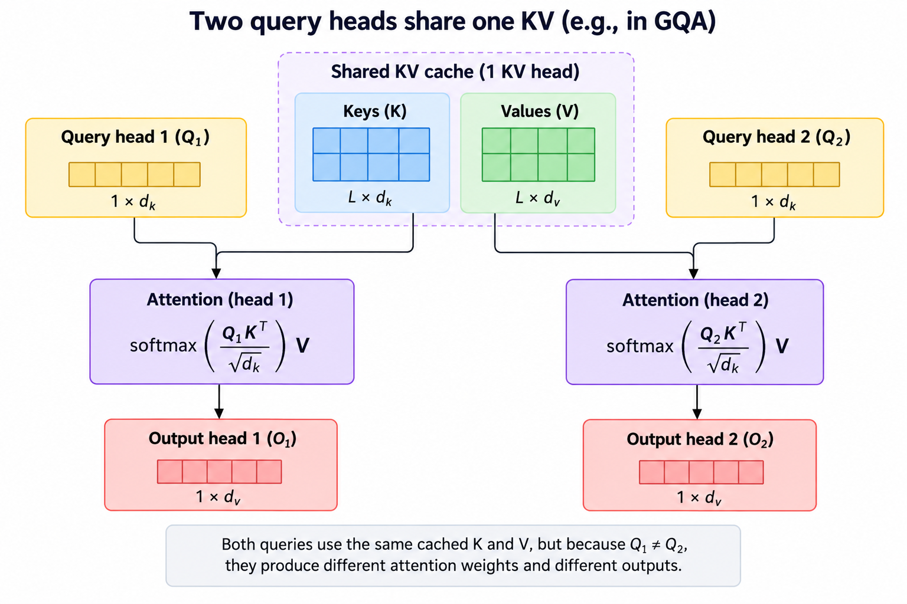
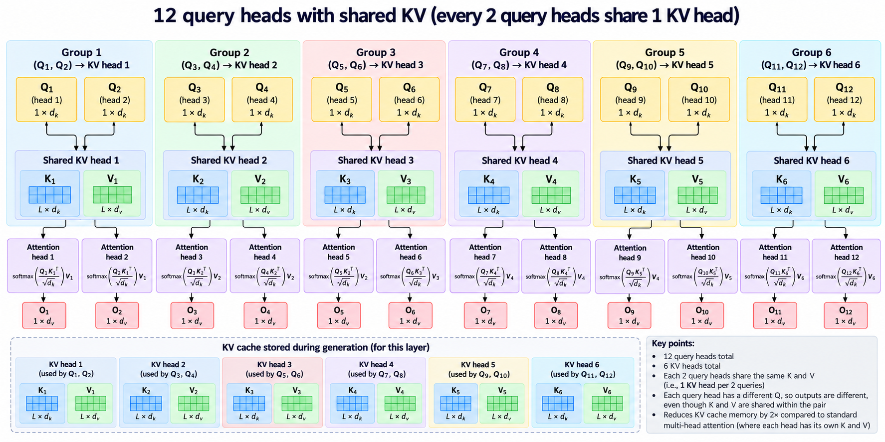
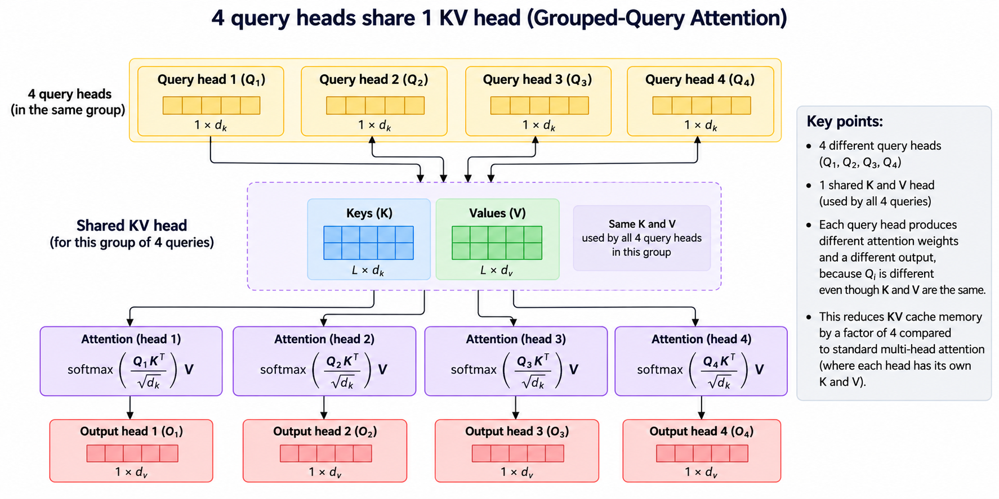
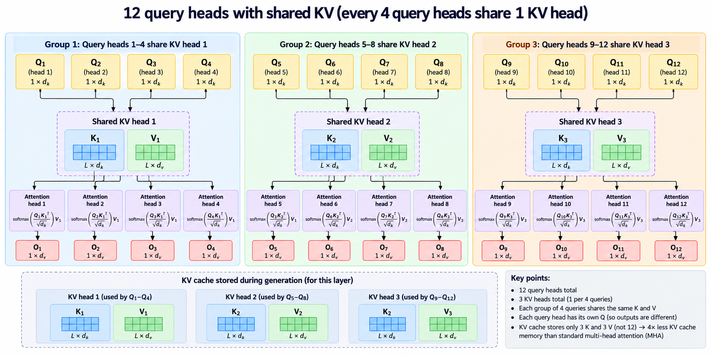

# Transformer Architecture Transformations: SHARED KV / GQA-GROUPED QUERY ATTENTION

 ## 🎯 1) Shared KV / Grouped Query Attention- GQA
 - Attention is softmax(Q*Kt) i.e. Q and K are multiplied first, this doesnt mean KV cannot be shared
 See below for explanation. 
 - Note in the below screen shots I have mixed up Shared KV and KV Caching. (I have erroneusely called it Shared KV Caching.). **SHARED KV != KV Caching.** They are 2 different things. Althought Shared KV could also use KV Caching
- **Shared KV (GQA/MQA):** Multiple Query heads share the same Key and Value heads. This reduces the number of K/V heads needed. 
- In GQA: grouped query attentions with shared KV # attention_heads = # query_heads. Each decoder layer will have attention_heads. Many decoder layers connected serially make the decoder layer (Note GQA is most commonly used in decoder transformer architectures, not in encoder transformer architectures)
- **KV Caching:** Stores previously computed K and V vectors so they don't need to be recomputed for subsequent tokens.
  
  
 
 
 ## 🎯 1.1) Shared KV : 2 queries share 1 KV 
 
  
  
 
 ## 🎯 1.2) Shared KV : 4 queries share 1 KV 
 
  
  
