# Transformer Architecture Transformations: FLASH ATTENTION

 ## 🎯 1) FLASH ATTENTION: WHAT IS IT. Lets ask ChatgPT ?
 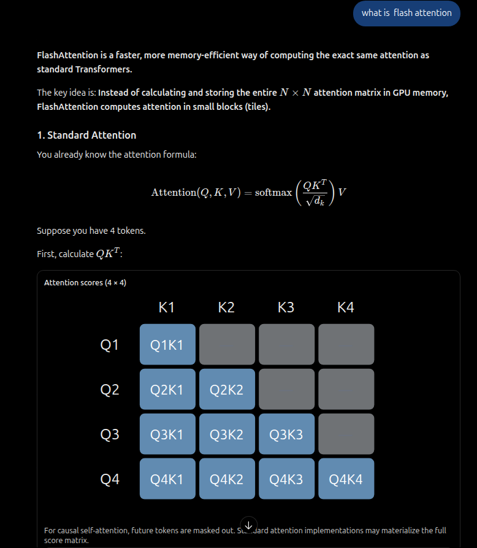 
 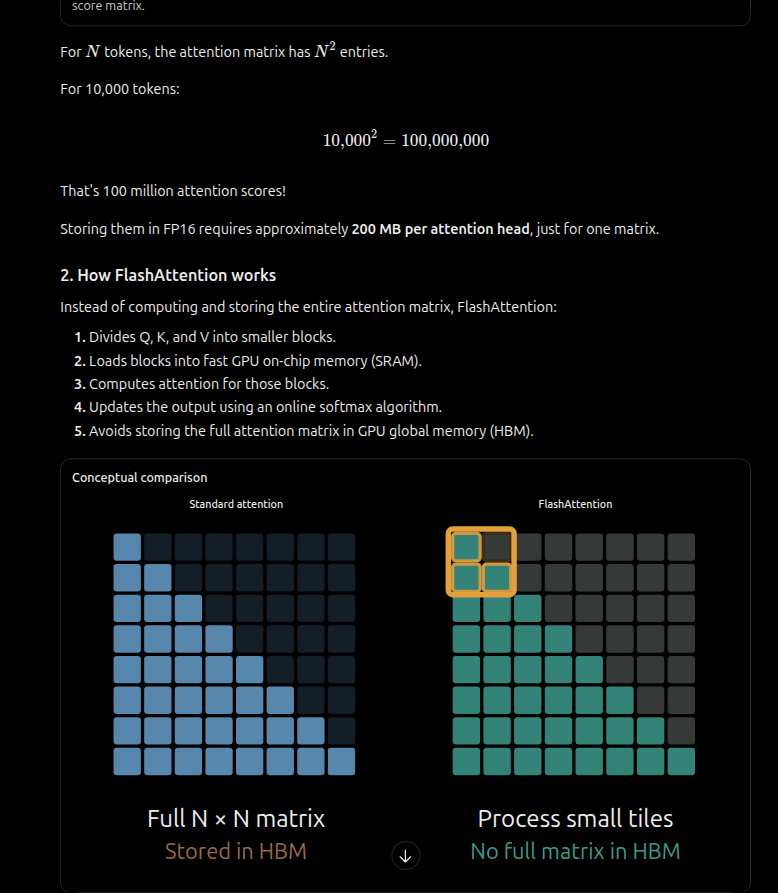 
 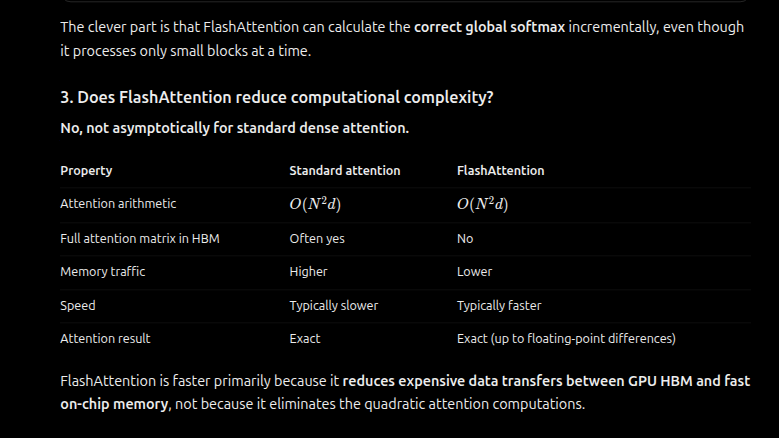

## 🎯 2) We only need the bottom right triangle of the Q*K Matrix . So WHY FLASH ATTENTION THEN ?
- We don't really need the entire QK matrix in causal attention. We only need the lower triangle + diagonal. This saves ~50% of the memory already
- So why do we need Flash Attention
Answer: 
- even the lower triangle is a lot of computation in one go
- most matrix operations are designed to calculate entire matrix even if top triangle of matrix is not needed
 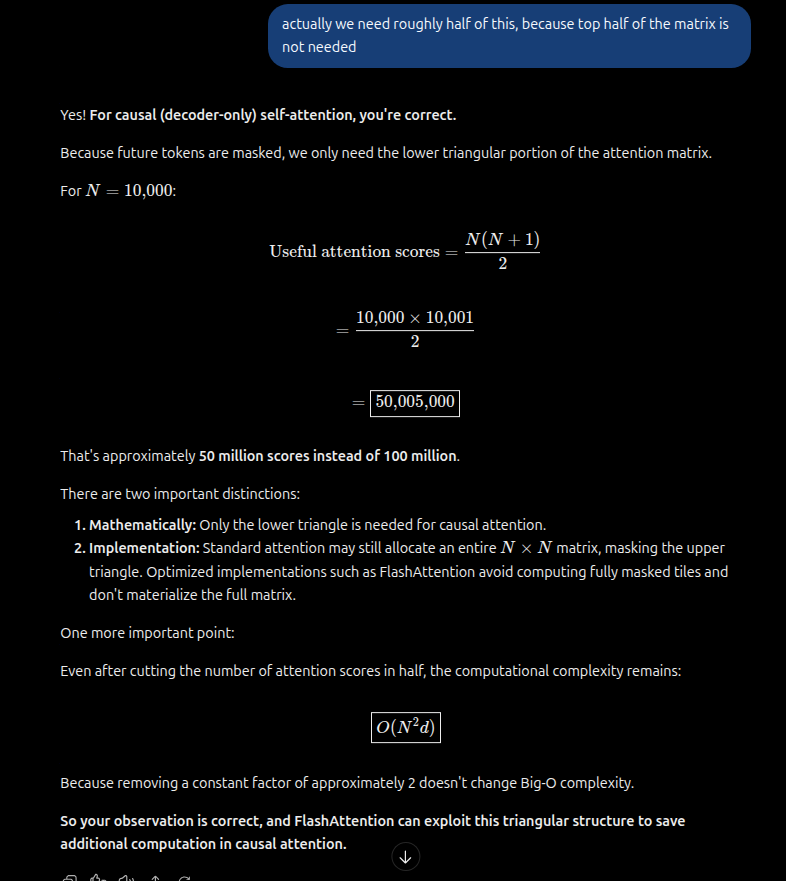 

## 🎯 3) PREFILL vs. DECODING: We dont even need a QK matrix. We only need one row at a time So WHY FLASH ATTENTION THEN ?
- Go back to [README_architecture_optimize_1_kv_cache.md](README_architecture_optimize_1_kv_cache.md). 
- Recall, while studying KV caching, we learnt that the entire QK matrix is never needed. We only need one row at a time, 1 row for every new token
- Example for token3: Q3*K1, Q3*K2, Q3*K3
        - for token4: Q4*K1, Q4*K2, Q4*K3, Q4*K4

Question: So why is flash attention is needed then , if there are no matrices and only rows ? \
Answer: 
- 1 row per 1 token is for new token generation. this part is the **DECODING**
- BUT FOR THE INTIAL TOKENS THAT ARE USED. The initial QT matrix is precomputed. This part is **PREFILLING**. So if the initial context or prompt is 10,000 words/ 10,000 tokens (like lets say the initial prompt is the Harry Potter Book1- The Philosphers stone). Then we would have 10K*10K matrix
 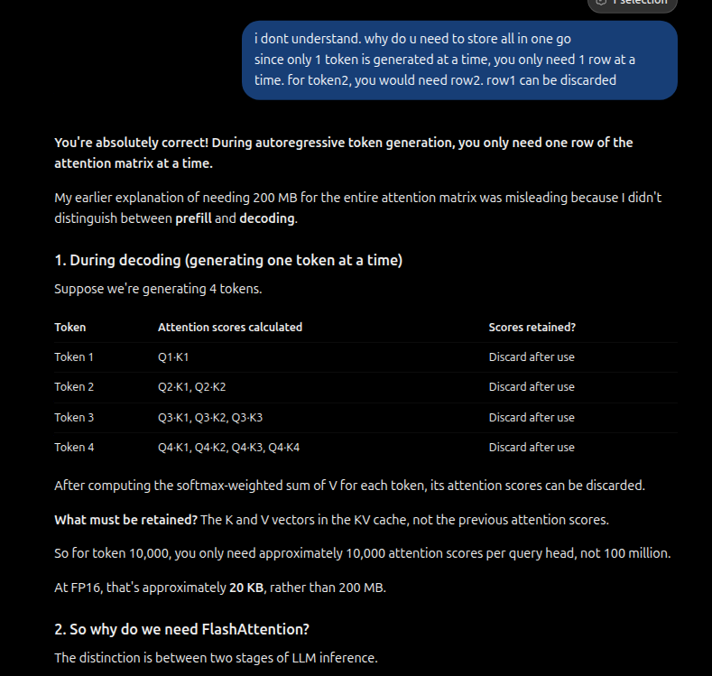 
 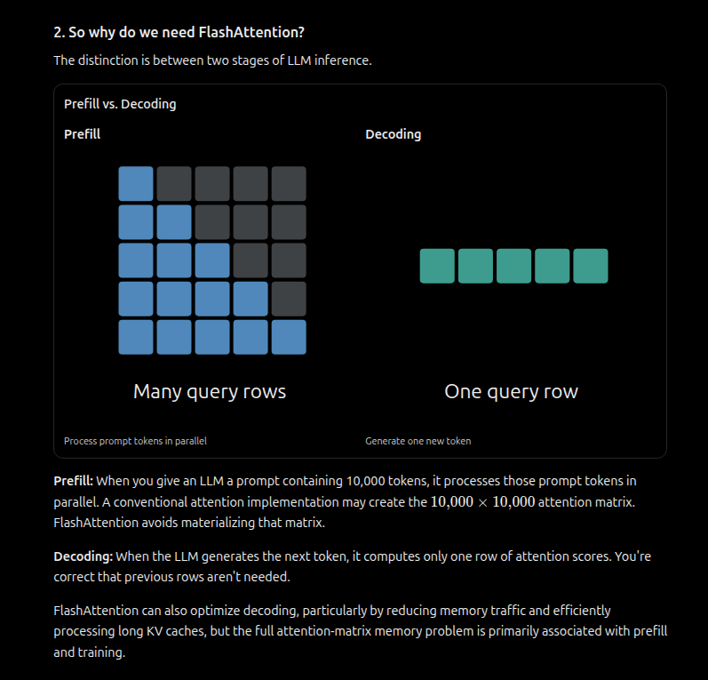 

 ## 🎯 3.1) PREFILLING EXAMPLE: The cat sat on the mat
 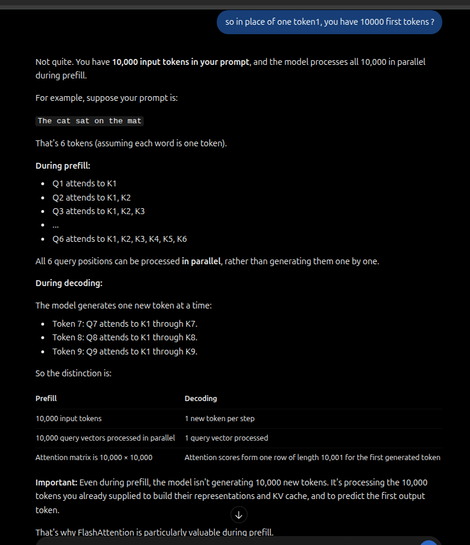

## 🎯 4) CHECK YOUR INUTITION: Is Flash Attention Just Tiling
Flash Attention is more than just filing. It has Kernel Fusion and online softmax
 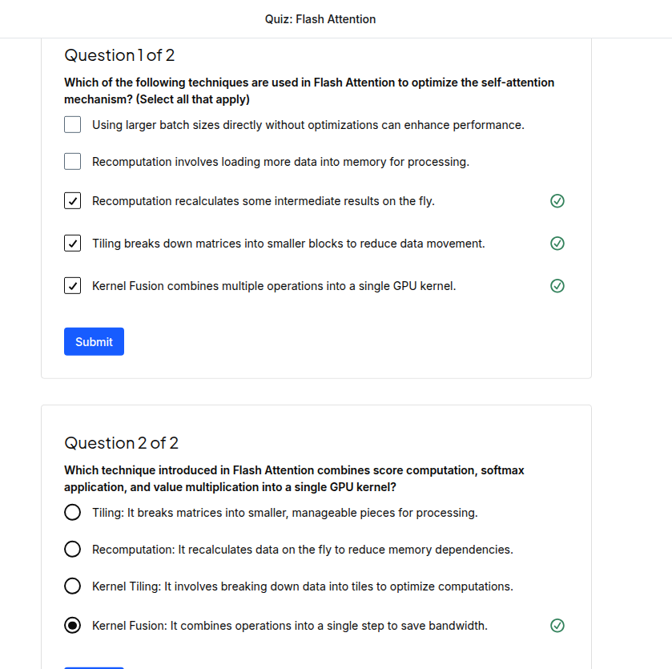 
 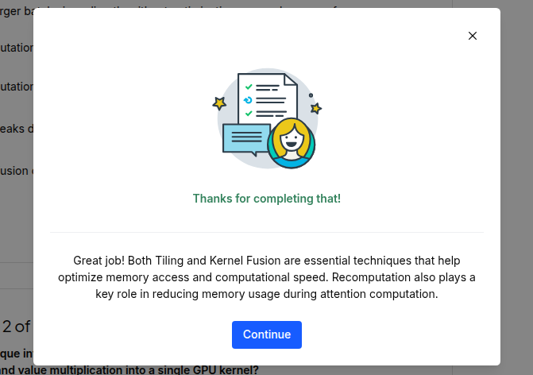 

## 🎯 4.1) FLASH ATTENTION = TILING + KERNEL FUSION + ONLINE SOFTMAX
 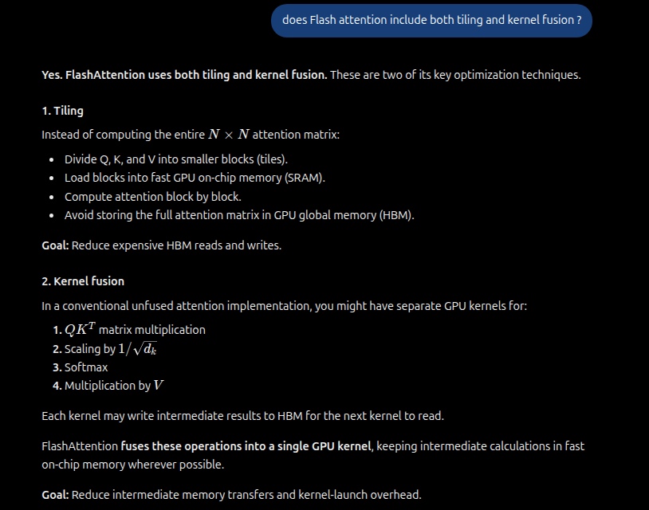 
 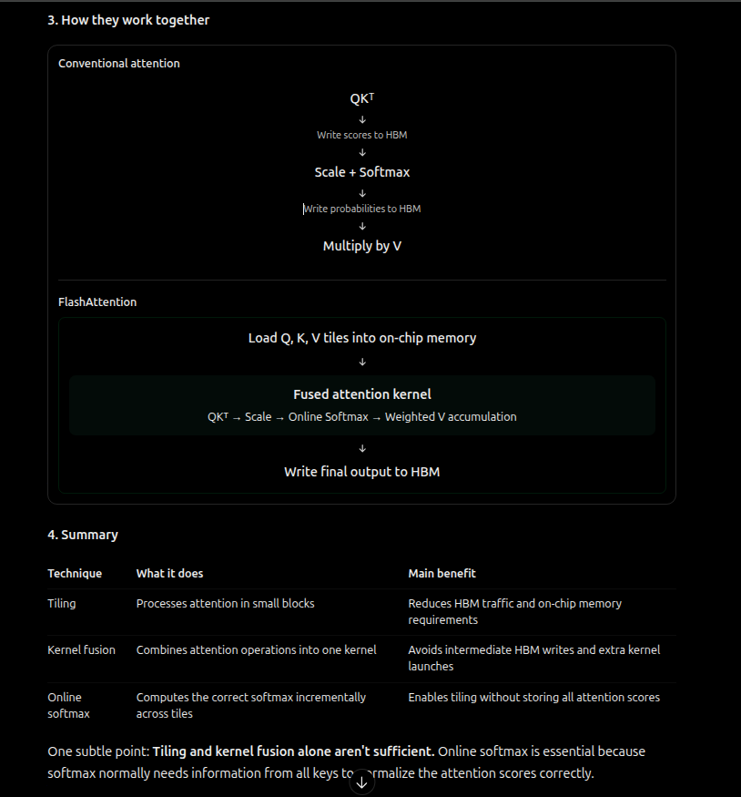 
 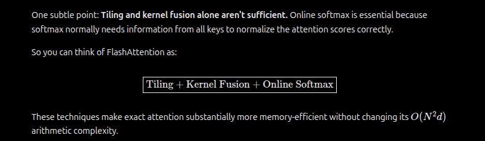

